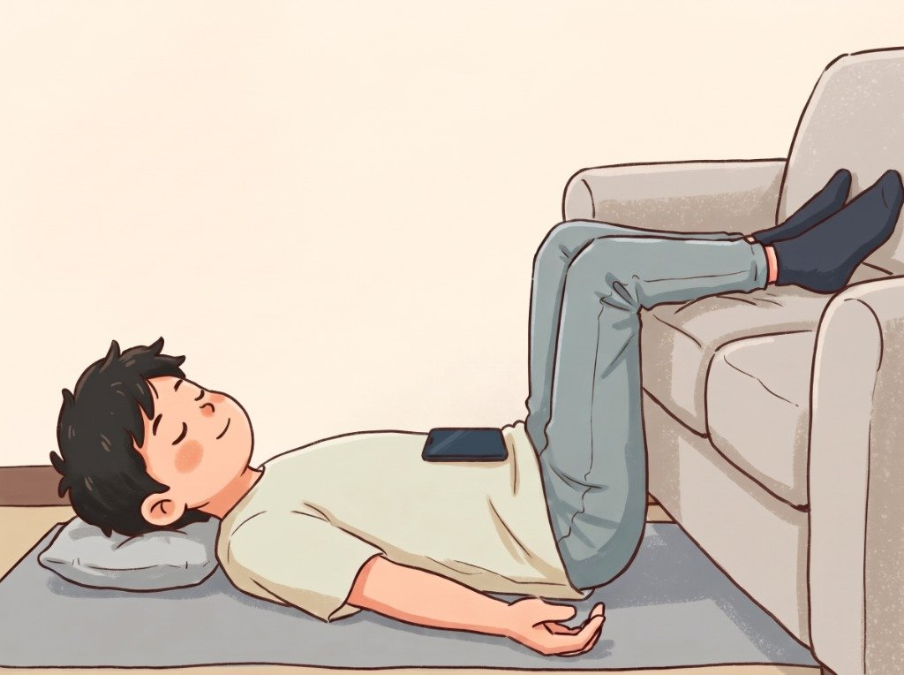

這套練習結合了物理治療中的「靜態背躺（Static Back）」與傳統「調身不調息」的放鬆心法，透過零重力支撐讓身體自行修復。

<h3 class="subtitle text-2xl font-serif text-primary mb-4">一、 姿勢的預設（調身準備）</h3>

<ul class="list-disc pl-6 mb-6 space-y-2">
    <li><strong>雙重 90 度支撐：</strong> 仰躺於地墊上，將小腿完全放鬆地架在椅子或沙發上。調整臀部與椅子的距離，使小腿與大腿呈 90 度，大腿與軀幹也呈 90 度（膝窩後方自然貼近椅緣即可，不需刻意用力勾住椅子）。</li>
    <li><strong>頭部微墊高度：</strong> 在頭下墊一個薄枕頭，讓下巴微微內收、視線垂直朝向天花板，避免頸部過度後仰或緊繃。</li>
    <li><strong>軀幹與骨盆貼地：</strong> 雙手自然放於身體兩側（與軀幹約呈 30～45 度角），掌心朝上，讓肩胛骨平貼地面。保持整個背部與下背（腰椎）自然平貼地墊，切勿刻意拱腰。</li>
    <li><strong>腹部觸覺提示：</strong> 在小腹（肚臍附近）放一個輕巧的物品（如手機）。</li>
</ul>

<h3 class="subtitle text-2xl font-serif text-primary mb-4">二、 注意事項（執行與安全細節）</h3>

<ul class="list-disc pl-6 mb-6 space-y-2">
    <li><strong>建議空腹練習：</strong> 盡量在空腹或飯後至少 1～1.5 小時後進行，避免飽腹平躺或小腹放置物品時對腸胃造成壓迫，同時讓橫膈膜擁有更充裕的下降空間。</li>
    <li><strong>完全放下控制：</strong> 姿勢擺好後，放棄一切後天意識（不數秒數、不刻意深呼吸），完全放鬆身體，交由身體自主進行自然呼吸。</li>
    <li><strong>練習時長與頻率：</strong> 建議每天練習 20～30 分鐘；如果時間有限，單次 5～10 分鐘也可以，重點是堅持每天做。</li>
    <li><strong>注意全身保暖：</strong> 長時間靜躺且進入深度放鬆狀態時，體溫與基礎代謝會稍微下降，建議在腹部或身上蓋一條薄毯，避免深層肌肉因受涼而產生保護性緊繃。</li>
    <li><strong>起身緩衝步驟：</strong> 練習結束後切勿直接仰臥起坐彈起來。應先將雙腳從椅子上輕輕滑落至地面，身體轉向側躺並停頓 5～10 秒，再用雙手撐地慢慢起身，避免剛放鬆的腰椎突然承受剪力或產生姿勢性頭暈。</li>
    <li><strong>椅子高度適配：</strong> 椅面高度應與你的大腿長度相符（讓大腿能垂直於地面）；若椅子太高導致臀部懸空、或太矮導致大腿傾斜，可用折疊的毛巾或瑜珈墊調整椅面或臀部高度。</li>
</ul>

<h3 class="subtitle text-2xl font-serif text-primary mb-4">三、 練習背後的邏輯（生理與神經機制）</h3>

這個動作的核心目的，在於利用重力與支撐物讓骨盆和肋骨回到中立位，解除腰背部（豎脊肌）與髖屈肌的緊繃，並讓橫膈膜恢復自然運作：

<h4 class="text-xl font-semibold text-primary mb-2">1. 給足身體「結構重設」的時間（20～30 分鐘的意義）</h4>
<ul class="list-disc pl-6 mb-6 space-y-2">
    <li><strong>深層筋膜與肌肉的緩慢釋放：</strong> 人體在日常站立、久坐或運動時，深層的腰大肌（Psoas）與下背部豎脊肌長期處於對抗重力的緊繃狀態。短短幾分鐘的練習往往只能舒緩表層肌群；維持 90/90 姿勢長達 20～30 分鐘，能讓深層筋膜與腰大肌在無重力負擔下有足夠時間徹底「放鬆」並歸位，使骨盆與脊椎回到最省力的中立結構。</li>
</ul>

<h4 class="text-xl font-semibold text-primary mb-2">2. 「放棄後天意識」對自律神經的價值</h4>
<ul class="list-disc pl-6 mb-6 space-y-2">
    <li><strong>切換至副交感神經模式：</strong> 刻意數秒數、控制吸吐深淺，容易讓大腦維持在「工作與監控」的狀態（交感神經微幅警覺）。當你擺好正確的物理支撐後完全放下控制，大腦的監控機制會徹底關閉，讓身體快速進入深度修復的副交感神經主導模式（休息與消化狀態）。</li>
</ul>

<h4 class="text-xl font-semibold text-primary mb-2">3. 結構決定功能（呼吸自然歸位）</h4>
<ul class="list-disc pl-6 mb-6 space-y-2">
    <li><strong>橫膈膜自動恢復效率：</strong> 只要骨盆與肋骨擺在正確的對位上（胸廓與骨盆底肌上下正對），橫膈膜就不需要大腦刻意指揮，自然會隨著身體的放鬆而加深、變慢。</li>
    <li><strong>無為導引呼吸：</strong> 放在小腹上的輕巧物品（如手機），正是用來「無為導引呼吸」的工具——不需要大腦刻意用力推擠或數拍子，僅憑物品本身的微弱重量與存在感，就能自然吸引氣息下沉至丹田（下腹），在不加干涉的狀態下順勢帶動深層腹式呼吸。</li>
</ul>

<h3 class="subtitle text-2xl font-serif text-primary mb-4">四、 練習中的常見反應（排病與釋放訊號）</h3>

在身體切換至副交感神經修復模式、氣血與深層筋膜開始鬆動時，可能會出現以下正常的良性反應（傳統養生稱「排病反應」，現代醫學稱為「神經與筋膜釋放反應」）：

<ul class="list-disc pl-6 mb-6 space-y-2">
    <li><strong>腸胃蠕動與排氣：</strong> 肚子頻繁發出咕嚕聲（腸鳴）、打嗝或排氣。這是副交感神經啟動後，原本緊繃的內臟平滑肌開始放鬆、消化系統恢復運作的典型徵兆。</li>
    <li><strong>神經系統釋放：</strong> 頻繁打哈欠、眼角泛淚、唾液增多，或四肢末端出現輕微的溫熱感、微麻感（氣血重新灌流至末梢），甚至在深層肌肉突然鬆開時出現短暫的身體輕微抽動。</li>
    <li><strong>舊傷或勞損部位的短暫酸脹：</strong> 原本長期緊繃的腰部、骨盆周圍或舊傷處，在筋膜「放鬆」過程中可能會感到一陣微酸、發脹或微熱，通常維持幾分鐘後便會隨之化開、變得更加輕鬆。</li>
    <li><strong>短暫的睡眠節律波動：</strong> 少數人在練習初期，因自律神經正在重新校準，可能會暫時出現失眠、入睡變淺或多夢的情況。只要確認練習姿勢正確，無需過度擔憂，繼續堅持練習，待身體完成調節後，睡眠品質便會自然改善。</li>
    <li><strong>反應過強時的調節原則：</strong> 排病反應講求循序漸進。如果某段時間反應太猛、身體感到負荷不了，可以<strong>暫停練習一兩天</strong>讓身體緩衝，或是將<strong>單次練習時間縮短至 5～10 分鐘</strong>，等身體適應後再逐步恢復時長。</li>
    <li><strong>【安全界線區分】</strong> 上述反應多為溫和、流動且令人感到釋放的；若練習當下出現<strong>尖銳刺痛、單側下肢劇烈麻木（如坐骨神經受壓）或頭暈噁心</strong>，則屬於姿勢角度不當（如椅子過高或椅緣壓迫膝窩神經），應立即微調姿勢或結束練習。</li>
</ul>
