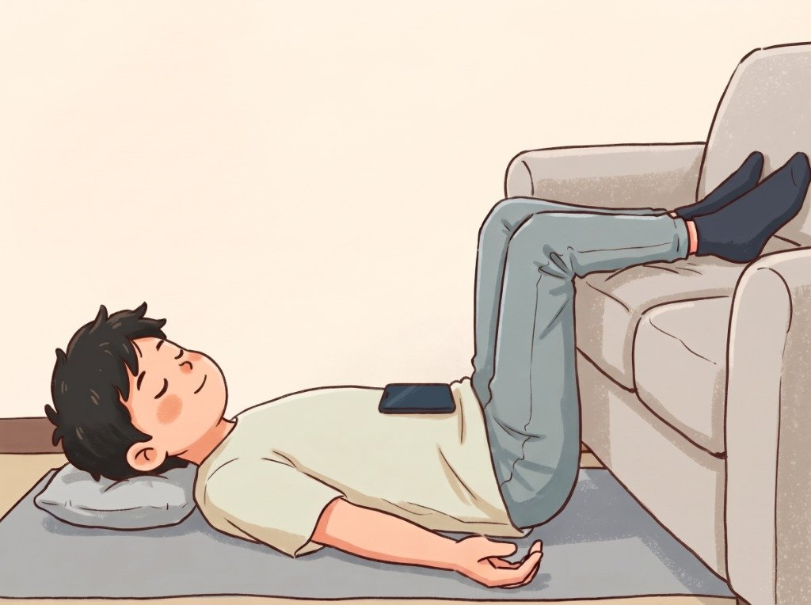

This practice combines the "Static Back" position from physical therapy with the traditional Eastern philosophy of "aligning the body without forcing the breath", allowing the body to self-repair through zero-gravity support.

<h3 class="subtitle text-2xl font-serif text-primary mb-4">1. Posture Setup (Body Alignment)</h3>

<ul class="list-disc pl-6 mb-6 space-y-2">
    <li><strong>Double 90-Degree Support:</strong> Lie flat on a mat with your calves resting completely relaxed on a chair or couch. Adjust the distance between your hips and the chair so that your calves and thighs form a 90-degree angle, and your thighs and torso also form a 90-degree angle (the backs of your knees should rest naturally near the edge of the seat without hooking or gripping).</li>
    <li><strong>Head Support:</strong> Place a thin pillow under your head so your chin is slightly tucked and your gaze points straight up toward the ceiling, preventing neck hyperextension or tension.</li>
    <li><strong>Neutral Spine & Pelvis:</strong> Rest your arms naturally at your sides (at roughly a 30–45 degree angle from your torso) with your palms facing up, allowing your shoulder blades to lie flat on the floor. Keep your entire back—especially your lower back (lumbar spine)—resting flat against the mat without arching.</li>
    <li><strong>Abdominal Tactile Cue:</strong> Place a lightweight object (such as a smartphone) on your lower abdomen.</li>
</ul>

<h3 class="subtitle text-2xl font-serif text-primary mb-4">2. Precautions & Execution Details</h3>

<ul class="list-disc pl-6 mb-6 space-y-2">
    <li><strong>Practice on an Empty Stomach:</strong> Aim to practice on an empty stomach or at least 1–1.5 hours after a meal. This prevents digestive discomfort or pressure from lying flat with an object on your lower abdomen, while giving your diaphragm ample room to descend freely.</li>
    <li><strong>Let Go of Control:</strong> Once your posture is set, release all conscious control—do not count seconds or force deep breaths. Relax your body completely and let natural, effortless breathing take over.</li>
    <li><strong>Duration & Frequency:</strong> Aim for 20–30 minutes daily. If your schedule is tight, a 5–10 minute session is also effective; the key is daily consistency.</li>
    <li><strong>Keep Warm:</strong> Lying still in deep relaxation causes your core temperature and basal metabolic rate to drop slightly. Cover your abdomen or body with a light blanket to prevent deep muscles from tensing up protectively against the chill.</li>
    <li><strong>Safe Transition When Getting Up:</strong> Never sit straight up abruptly when finished. Gently slide your legs off the chair onto the floor, roll onto your side and pause for 5–10 seconds, then use your hands to push yourself up slowly. This protects your newly relaxed lumbar spine from sudden shear stress and prevents postural dizziness.</li>
    <li><strong>Chair Height Adjustment:</strong> The seat height should match the length of your thighs so that your thighs remain vertical to the floor. If the chair is too high (lifting your hips off the floor) or too low (tilting your thighs), use folded towels or a yoga mat to adjust the height of the seat or your hips.</li>
</ul>

<h3 class="subtitle text-2xl font-serif text-primary mb-4">3. The Logic Behind the Practice (Physiological & Neurological Mechanisms)</h3>

The core purpose of this position is to use gravity and physical support to bring the pelvis and ribcage back into neutral alignment, release tight lower back muscles (erector spinae) and hip flexors, and restore natural diaphragmatic function:

<h4 class="text-xl font-semibold text-primary mb-2">3.1. Giving the Body Time for a "Structural Reset" (Why 20–30 Minutes Matters)</h4>
<ul class="list-disc pl-6 mb-6 space-y-2">
    <li><strong>Gradual Release of Deep Fascia & Muscles:</strong> During daily standing, prolonged sitting, or exercise, the deep psoas muscles and lower back erector spinae remain in chronic tension fighting gravity. A few minutes of rest only relaxes superficial muscles; holding the 90/90 position for 20–30 minutes gives deep fascia and the psoas enough time to thoroughly relax and realign in a zero-gravity state, returning the pelvis and spine to their most effortless neutral structure.</li>
</ul>

<h4 class="text-xl font-semibold text-primary mb-2">3.2. The Value of "Releasing Conscious Control" for the Autonomic Nervous System</h4>
<ul class="list-disc pl-6 mb-6 space-y-2">
    <li><strong>Shifting to the Parasympathetic Mode:</strong> Deliberately counting seconds or controlling breath depth keeps the brain in a state of active monitoring (subtle sympathetic alertness). Once physical alignment is established and you let go of control, the brain's monitoring mechanism shuts down, allowing the body to rapidly shift into the restorative parasympathetic mode ("rest and digest").</li>
</ul>

<h4 class="text-xl font-semibold text-primary mb-2">3.3. Structure Dictates Function (Natural Breath Restoration)</h4>
<ul class="list-disc pl-6 mb-6 space-y-2">
    <li><strong>Automatic Diaphragmatic Efficiency:</strong> When the pelvis and ribcage are properly stacked (ribcage aligned directly over the pelvic floor), the diaphragm requires no conscious direction—it naturally deepens and slows down as the body relaxes.</li>
    <li><strong>Effortless Breath Guidance (<em>Wu Wei</em>):</strong> The lightweight object on your lower abdomen (such as a phone) serves to guide the breath effortlessly. Without forcing your belly or counting beats, the gentle weight and physical presence of the object naturally draw the breath downward into the lower abdomen (<em>Dantian</em>), encouraging deep diaphragmatic breathing without interference.</li>
</ul>

<h3 class="subtitle text-2xl font-serif text-primary mb-4">4. Common Reactions During Practice (Detox & Release Signals)</h3>

As the body shifts into parasympathetic repair mode and deep fascia and circulation begin to open up, you may experience benign physiological releases (known in traditional wellness as "healing/detox reactions" and in modern medicine as "neuro-fascial release responses"):

<ul class="list-disc pl-6 mb-6 space-y-2">
    <li><strong>Gut Motility & Gas Release:</strong> Frequent stomach gurgling (borborygmi), burping, or passing gas. This is a classic sign that parasympathetic activation has relaxed tense visceral smooth muscles and restored digestive motility.</li>
    <li><strong>Nervous System Release:</strong> Frequent yawning, watery eyes, increased salivation, mild warmth or tingling in the extremities (as circulation returns to peripheral tissues), or brief, involuntary muscle twitches as deep tension suddenly lets go.</li>
    <li><strong>Temporary Achiness in Old Injuries or Tight Areas:</strong> Previously tight areas around the lower back, pelvis, or old injuries may feel a mild ache, fullness, or warmth as fascia softens; this typically dissipates within a few minutes, leaving the area noticeably lighter.</li>
    <li><strong>Temporary Sleep Fluctuations:</strong> A small number of practitioners may initially experience temporary insomnia, lighter sleep, or vivid dreams as the autonomic nervous system recalibrates. Provided your alignment is correct, there is no need to worry—continuing the practice consistently will allow your sleep quality to naturally improve once your body completes its adjustment.</li>
    <li><strong>Pacing When Reactions Feel Intense:</strong> Release responses work best gradually. If reactions feel overwhelming or uncomfortable, <strong>pause the practice for a day or two</strong> to let your body integrate, or <strong>shorten single sessions to 5–10 minutes</strong> until your body adapts before gradually increasing the duration again.</li>
    <li><strong>Safety Boundary:</strong> The normal reactions above feel gentle, fluid, and relieving. If you experience <strong>sharp pain, severe unilateral leg numbness (such as sciatic nerve compression), or dizziness/nausea</strong>, your alignment is off (e.g., chair height is incorrect or the edge is pressing into the back of your knees)—adjust your setup immediately or end the session.</li>
</ul>
